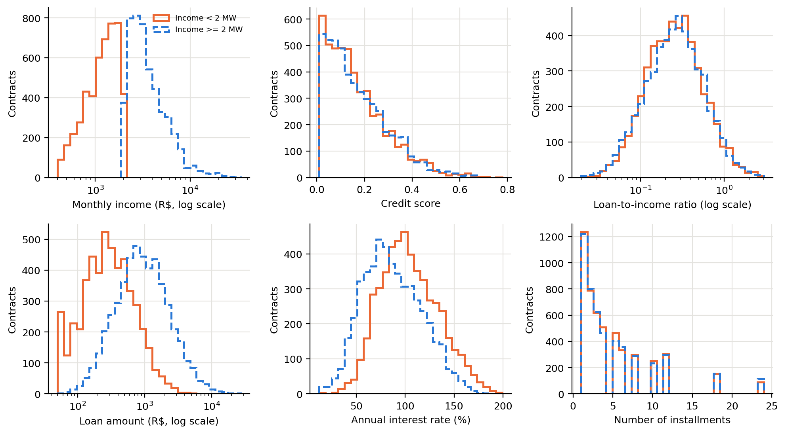
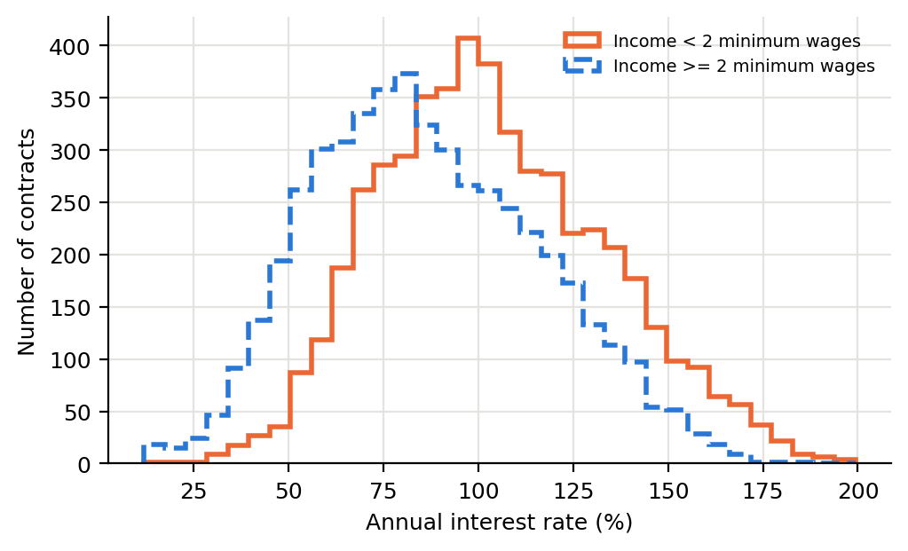
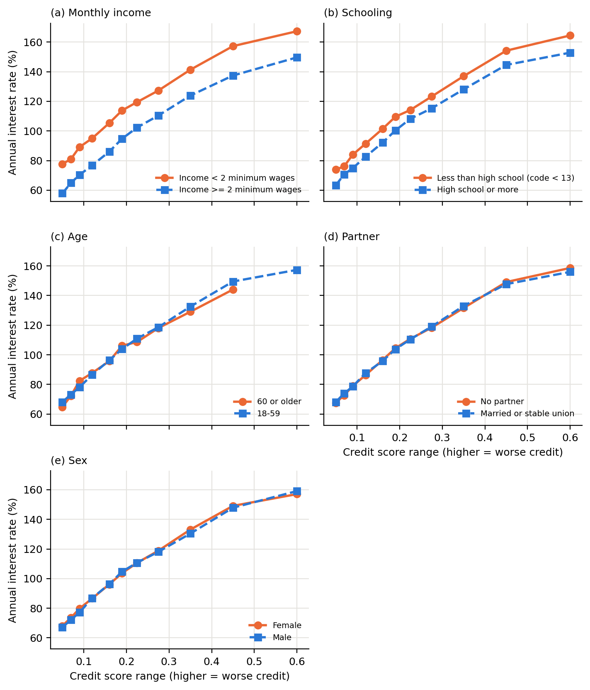
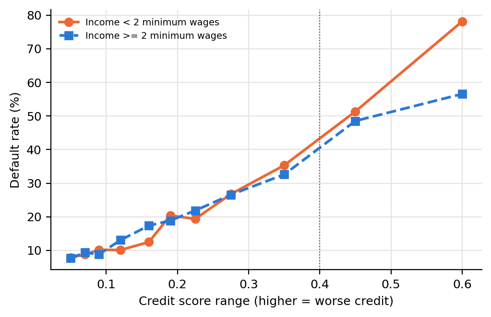
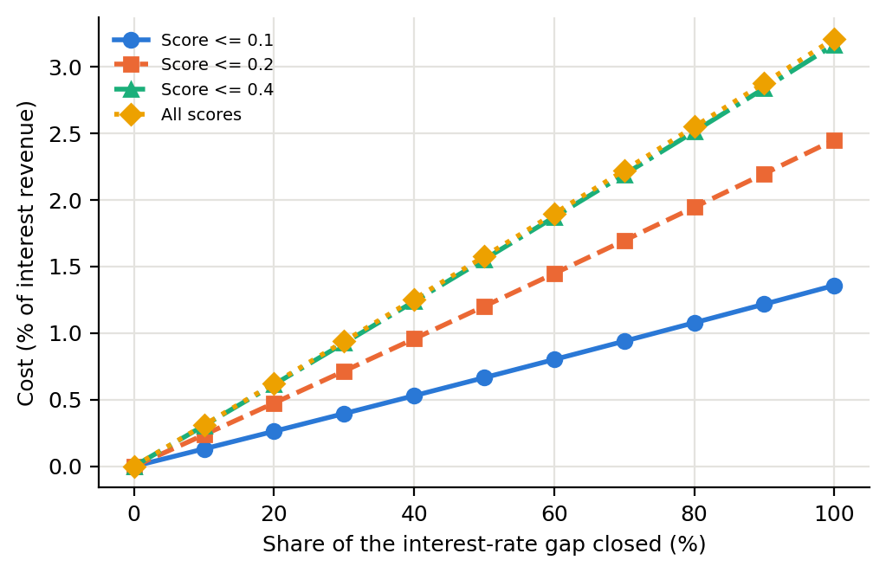

# Income case study on synthetic data

Fully artificial data (`data/Synthetic_Income_Dataset.csv`, built by `src/SyntheticIncome.py`). By construction, borrowers earning less than R$ 2,000 have the same credit-score and loan-to-income distributions as the others but pay 18 p.p. more per year. These are not findings about any bank.

## 1. The data

| IncomeGroup | contracts | clients | median_income | mean_score | median_loan_to_income | median_loan | mean_annual_rate | default_rate |
|---|---|---|---|---|---|---|---|---|
| < 2 MW | 5044 | 2459 | 1218.68 | 0.169 | 0.254 | 280.0 | 104.068 | 0.18 |
| >= 2 MW | 4956 | 2442 | 3223.415 | 0.172 | 0.26 | 900.0 | 86.767 | 0.184 |

Same score and loan-to-income ratio; different rates. Distributions: `fig_data_distributions.png`.

## 2. Table 4: annual rate by credit-score range and income group

| Credit score range | Default <2MW | Qty <2MW | Avg IR <2MW | Loan <2MW | Default >=2MW | Qty >=2MW | Avg IR >=2MW | Loan >=2MW | IR difference | IR % difference |
|---|---|---|---|---|---|---|---|---|---|---|
| (0.0, 0.04] | 0.09 | 680.0 | 69.06 | 375.0 | 0.08 | 611.0 | 50.94 | 1427.87 | 18.12 | 12.0 |
| (0.04, 0.06] | 0.08 | 381.0 | 77.72 | 429.19 | 0.08 | 387.0 | 57.89 | 1426.02 | 19.83 | 12.6 |
| (0.06, 0.08] | 0.09 | 387.0 | 81.01 | 434.65 | 0.09 | 374.0 | 64.87 | 1336.76 | 16.14 | 9.8 |
| (0.08, 0.1] | 0.1 | 344.0 | 89.07 | 387.85 | 0.09 | 418.0 | 70.33 | 1276.32 | 18.74 | 11.0 |
| (0.1, 0.14] | 0.1 | 771.0 | 95.08 | 408.7 | 0.13 | 650.0 | 76.82 | 1423.98 | 18.26 | 10.3 |
| (0.14, 0.18] | 0.12 | 568.0 | 105.35 | 426.95 | 0.17 | 512.0 | 86.06 | 1554.04 | 19.29 | 10.4 |
| (0.18, 0.2] | 0.2 | 245.0 | 113.88 | 446.04 | 0.19 | 254.0 | 94.79 | 1343.54 | 19.09 | 9.8 |
| (0.2, 0.25] | 0.19 | 506.0 | 119.48 | 413.12 | 0.22 | 535.0 | 102.31 | 1511.36 | 17.17 | 8.5 |
| (0.25, 0.3] | 0.27 | 370.0 | 127.29 | 423.24 | 0.27 | 399.0 | 110.41 | 1267.02 | 16.88 | 8.0 |
| (0.3, 0.4] | 0.35 | 484.0 | 141.35 | 413.06 | 0.33 | 546.0 | 123.89 | 1390.75 | 17.46 | 7.8 |
| (0.4, 0.5] | 0.51 | 220.0 | 157.29 | 403.73 | 0.49 | 171.0 | 137.44 | 1342.46 | 19.85 | 8.4 |
| (0.5, 0.7] | 0.78 | 87.0 | 167.35 | 440.69 | 0.57 | 99.0 | 149.68 | 1614.24 | 17.67 | 7.1 |
| (0.7, 0.9] | 0.0 | 1.0 | 177.25 | 520.0 | nan | nan | nan | nan | nan | nan |

## 3. Fairness metrics (Eq. 1 and Eq. 2) in score x loan-to-income cells

- Valid cells (>= 30 contracts in each group): 51 of 73 (contracts in valid cells: 9,183)
- Eq. 1 (simple mean of cell gaps): 18.46 p.p.
- Eq. 2 (weighted by cell size): 18.06 p.p.

## 4. Statistical test: cell fixed effects, standard errors clustered by client

- Score x loan-to-income cells: lower-income borrowers pay 18.06 p.p. more (95% CI 17.46 to 18.66; p = 0). True value built into the data: 18 p.p.
- Robustness, score x absolute loan amount x installments: 19.29 p.p. (95% CI 14.35 to 24.22). In these synthetic data the price does not depend on loan size, so the gap does not reverse; in the bank data it does (see the paper).

Equivalence test (TOST) on the main estimate:

| margin_pp | ci90_low | ci90_high | p_value_tost | equivalent |
|---|---|---|---|---|
| 1.0 | 17.553 | 18.56 | 1.0 | False |
| 2.0 | 17.553 | 18.56 | 1.0 | False |
| 5.0 | 17.553 | 18.56 | 1.0 | False |

## 5. Weighted Demographic Fairness Index

- With group shares and weights e^-i: 0.862
- With group shares, no weights: 0.205
- With absolute counts (Eq. 3 as first written, for comparison): 0.860

## 6. Cost of fairness

- Interest revenue over each loan's term: R$ 1,305,209
- Closing 100% of the gap for lower-income borrowers with score <= 0.4: 4,513 contracts, R$ 41,323, 3.17% of interest revenue (Eq. 4 comparison: 3.76%).
- The cost grows linearly with the share of the gap closed (`fig6_cost_curve.png`).

Table 5: cost by credit-score range (score <= 0.4, 100% of the gap):

| Credit score range | contracts | avg_reduction | cost | cost_pct_interest_revenue |
|---|---|---|---|---|
| (0.2, 0.25] | 487 | 16.78 | 3538.33 | 0.27 |
| (0.06, 0.08] | 369 | 16.73 | 3713.33 | 0.28 |
| (0.3, 0.4] | 469 | 17.52 | 3176.11 | 0.24 |
| (0.14, 0.18] | 539 | 19.3 | 5042.35 | 0.39 |
| (0.0, 0.04] | 662 | 17.93 | 7049.0 | 0.54 |
| (0.04, 0.06] | 363 | 19.63 | 4042.47 | 0.31 |
| (0.1, 0.14] | 735 | 18.1 | 7684.23 | 0.59 |
| (0.08, 0.1] | 331 | 18.45 | 2924.79 | 0.22 |
| (0.18, 0.2] | 200 | 19.14 | 1538.28 | 0.12 |
| (0.25, 0.3] | 358 | 16.61 | 2613.75 | 0.2 |

## Figures

