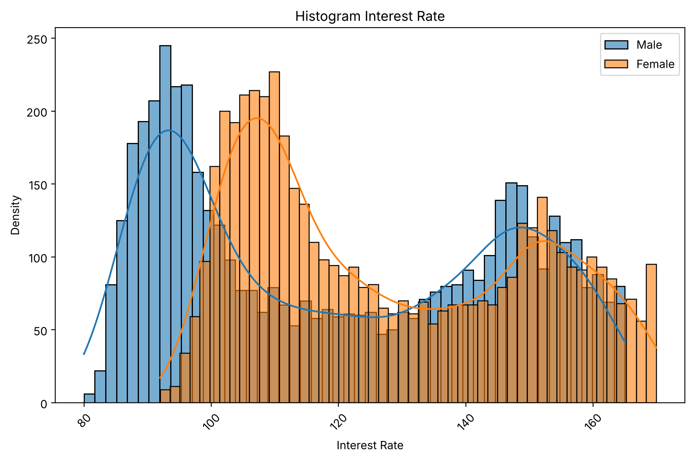
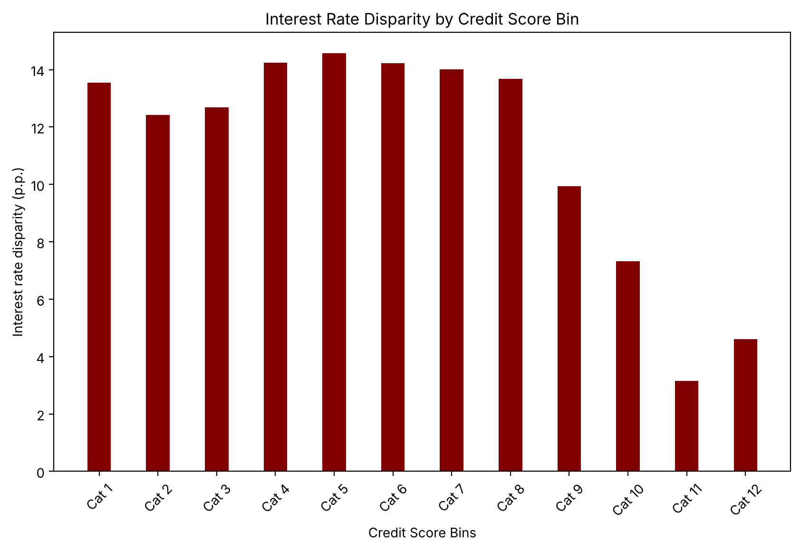

# Cost of fairness: results on the simulated dataset

Generated by `run_analysis.py` from `data/Simulated_Dataset.csv`. The dataset is simulated and illustrates the method; the bank dataset analyzed in the paper is confidential and is not part of this repository.

## 1. Dataset

| Group | Clients | Average loan amount | Average interest rate (%) | Default rate |
|---|---|---|---|---|
| All | 10000 | 7,918.23 | 123.86 | 0.49 |
| Female | 5037 | 7,888.17 | 127.90 | 0.49 |
| Male | 4963 | 7,948.75 | 119.76 | 0.49 |

This histogram corresponds to Figure 4 of the paper.

## 2. Fairness metrics

Disparity is the average interest rate of female clients minus that of male clients with the same credit score, in percentage points.

- Simple average interest rate comparison (Eq. 1): **11.20**
- Weighted-average interest rate comparison (Eq. 2): **8.48**
- Weighted Demographic Fairness Index, WDI (Eq. 3): **0.95**
- Weighted disparity among clients who repaid (equality of opportunity): **5.36**
- Weighted disparity including clients who defaulted (equality of odds): **8.47**

### Disparity by credit score bin

| bin | n_Female | n_Male | rate_Female | rate_Male | disparity | t_stat | p_value |
|---|---|---|---|---|---|---|---|
| Cat 1 | 146 | 130 | 103.42 | 89.87 | 13.54 | 25.60 | 4.81e-74 |
| Cat 2 | 62 | 47 | 102.65 | 90.23 | 12.42 | 14.43 | 2.06e-26 |
| Cat 3 | 58 | 58 | 103.18 | 90.49 | 12.69 | 16.40 | 1.31e-31 |
| Cat 4 | 190 | 183 | 104.07 | 89.83 | 14.24 | 32.01 | 2.03e-108 |
| Cat 5 | 111 | 121 | 105.01 | 90.44 | 14.57 | 25.45 | 1.09e-66 |
| Cat 6 | 274 | 283 | 104.91 | 90.68 | 14.23 | 36.70 | 1.21e-149 |
| Cat 7 | 297 | 272 | 105.90 | 91.89 | 14.01 | 36.98 | 3.10e-153 |
| Cat 8 | 562 | 564 | 108.58 | 94.91 | 13.67 | 46.18 | 2.06e-259 |
| Cat 9 | 596 | 568 | 112.57 | 102.65 | 9.93 | 28.97 | 3.07e-139 |
| Cat 10 | 571 | 570 | 123.68 | 116.36 | 7.32 | 18.25 | 1.80e-65 |
| Cat 11 | 570 | 556 | 136.07 | 132.91 | 3.16 | 7.27 | 6.84e-13 |
| Cat 12 | 1600 | 1611 | 155.52 | 150.91 | 4.61 | 16.71 | 3.81e-60 |

A p-value below 0.05 indicates a statistically significant difference between the two groups in that bin (Welch t-test).

### Clients by interest rate range (input of the WDI)

| InterestRateBin | Female | Male |
|---|---|---|
| 80-85 | 0 | 104 |
| 85-90 | 0 | 483 |
| 90-95 | 18 | 649 |
| 95-100 | 211 | 528 |
| 100-105 | 603 | 300 |
| 105-110 | 701 | 209 |
| 110-120 | 860 | 367 |
| 120-130 | 489 | 335 |
| 130-150 | 947 | 1174 |
| 150-160 | 700 | 581 |
| 160-170 | 508 | 233 |

## 3. Cost of fairness

Cost per credit score bin = share of paid contracts x average loan x rate reduction (as a fraction) x number of contracts, summed over the bins that receive the adjustment. Only the discriminated group has its rate reduced.

- Removing 20% of the gap in the 4 best credit score bins: **18,819.36**
- Removing 100% of the gap in all bins: **1,240,499.94**
- Decaying adjustment (50% in the best bin, 40% in the next): **15,990.76**
- Interest income from paid contracts, for scale: **34,552,950.53** (removing the whole gap costs 3.6% of it)

### Cost by share of the gap removed and bins covered

| share_of_gap_removed | Cat 1 to 1 | Cat 1 to 2 | Cat 1 to 3 | Cat 1 to 4 | Cat 1 to 5 | Cat 1 to 6 | Cat 1 to 7 | Cat 1 to 8 | Cat 1 to 9 | Cat 1 to 10 | Cat 1 to 11 | Cat 1 to 12 |
|---|---|---|---|---|---|---|---|---|---|---|---|---|
| 0% | 0 | 0 | 0 | 0 | 0 | 0 | 0 | 0 | 0 | 0 | 0 | 0 |
| 10% | 2,348 | 3,411 | 4,542 | 9,410 | 12,843 | 22,770 | 35,074 | 61,931 | 85,416 | 101,567 | 108,718 | 124,050 |
| 20% | 4,696 | 6,821 | 9,085 | 18,819 | 25,686 | 45,540 | 70,147 | 123,863 | 170,831 | 203,134 | 217,435 | 248,100 |
| 30% | 7,044 | 10,232 | 13,627 | 28,229 | 38,529 | 68,311 | 105,221 | 185,794 | 256,247 | 304,701 | 326,153 | 372,150 |
| 40% | 9,392 | 13,643 | 18,169 | 37,639 | 51,372 | 91,081 | 140,294 | 247,726 | 341,663 | 406,268 | 434,870 | 496,200 |
| 50% | 11,739 | 17,054 | 22,711 | 47,048 | 64,215 | 113,851 | 175,368 | 309,657 | 427,078 | 507,835 | 543,588 | 620,250 |
| 60% | 14,087 | 20,464 | 27,254 | 56,458 | 77,058 | 136,621 | 210,442 | 371,589 | 512,494 | 609,402 | 652,305 | 744,300 |
| 70% | 16,435 | 23,875 | 31,796 | 65,868 | 89,901 | 159,391 | 245,515 | 433,520 | 597,910 | 710,969 | 761,023 | 868,350 |
| 80% | 18,783 | 27,286 | 36,338 | 75,277 | 102,744 | 182,162 | 280,589 | 495,451 | 683,325 | 812,536 | 869,740 | 992,400 |
| 90% | 21,131 | 30,696 | 40,880 | 84,687 | 115,587 | 204,932 | 315,663 | 557,383 | 768,741 | 914,103 | 978,458 | 1,116,450 |
| 100% | 23,479 | 34,107 | 45,423 | 94,097 | 128,430 | 227,702 | 350,736 | 619,314 | 854,157 | 1,015,670 | 1,087,175 | 1,240,500 |

Figure 6 of the paper is a conceptual illustration of this trade-off; the chart above is the same analysis computed on the simulated dataset.
