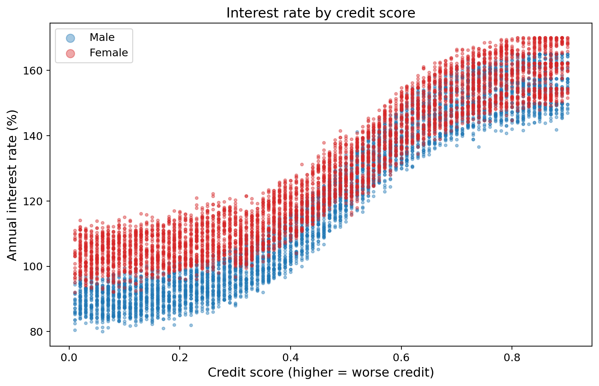
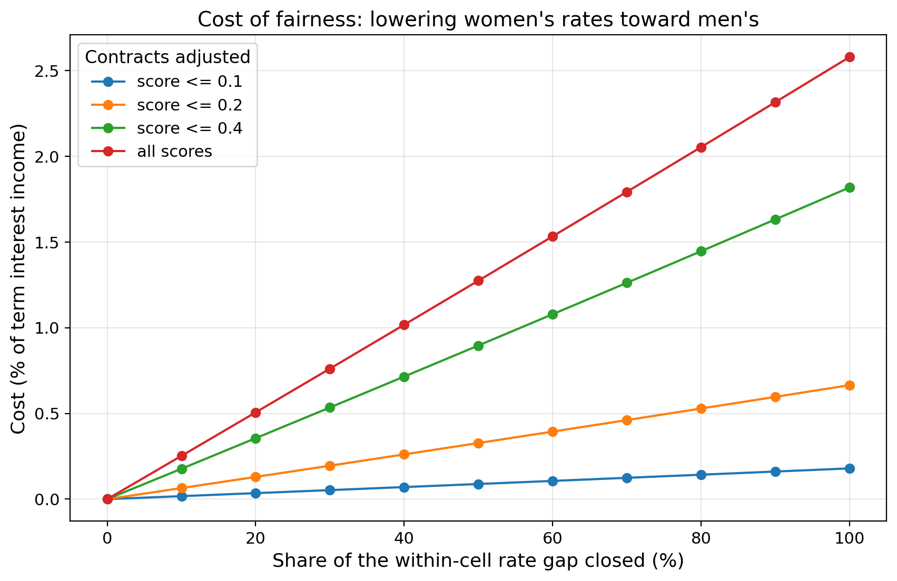

# Cost of fairness: results on the simulated dataset

Generated by `run_analysis.py` from `data/Simulated_Dataset.csv`. The dataset is simulated and illustrates the method; the bank dataset analyzed in the paper is confidential, and neither its data nor any number computed from it is part of this repository.

## 1. Dataset

| Group | Contracts | Average loan amount (R$) | Average annual interest rate (%) | Average credit score | Default rate |
|---|---|---|---|---|---|
| All | 10000 | 7,918.23 | 123.86 | 0.45 | 0.49 |
| Female | 5037 | 7,888.17 | 127.90 | 0.45 | 0.49 |
| Male | 4963 | 7,948.75 | 119.76 | 0.45 | 0.49 |

Number of contracts by annual interest rate (Figure 4 of the paper).

## 2. Rate gap within comparable cells (Eq. 1 and Eq. 2)

A comparable cell groups contracts with the same credit score bin, loan amount bin (R$ 2,000 wide) and number of installments. In the paper the cells are credit score x (loan amount / income); the simulated dataset has no income, so the loan amount and the number of installments stand in for it. The gap of a cell is the average annual rate of women minus that of men, in percentage points (p.p.); positive means women pay more. A cell is used only if it has at least 30 contracts of each group.

- Cells: **57** in total, **43** valid, 14 dropped for having fewer than 30 contracts of a group
- Contracts in valid cells: **9,449** of 10,000
- Valid cells where women pay more: **43** of 43
- Eq. 1, simple mean of the cell gaps: **9.05 p.p.** (95% CI [8.92, 9.17])
- Eq. 2, mean weighted by the contracts in each cell: **8.27 p.p.** (95% CI [8.15, 8.39])

These intervals treat contracts as independent; the formal test is the regression in Section 3.

### Gap by credit score bin

| score_bin | cells_valid | contracts | eq1 | eq2 | ci_low | ci_high |
|---|---|---|---|---|---|---|
| 0-0.03 | 3 | 276 | 13.66 | 13.64 | 13.13 | 14.16 |
| 0.05-0.08 | 2 | 159 | 13.63 | 13.71 | 12.99 | 14.42 |
| 0.08-0.1 | 2 | 163 | 13.90 | 13.95 | 13.27 | 14.63 |
| 0.1-0.15 | 3 | 557 | 13.82 | 13.82 | 13.44 | 14.21 |
| 0.15-0.2 | 3 | 526 | 13.91 | 13.89 | 13.51 | 14.28 |
| 0.2-0.3 | 3 | 1126 | 14.12 | 14.11 | 13.78 | 14.43 |
| 0.3-0.4 | 6 | 1164 | 9.76 | 10.03 | 9.67 | 10.39 |
| 0.4-0.5 | 6 | 1141 | 7.76 | 7.75 | 7.38 | 8.13 |
| 0.5-0.6 | 6 | 1126 | 3.53 | 3.46 | 3.00 | 3.91 |
| 0.6-0.9 | 9 | 3211 | 4.57 | 4.55 | 4.35 | 4.74 |

### Gap by repayment outcome

Eq. 2 computed separately among repaid contracts (equality of opportunity) and defaulted contracts (equality of odds).

| Contracts | cells_valid | Eq. 2 (p.p.) | 95% CI |
|---|---|---|---|
| Repaid | 33 | 10.73 | [10.56, 10.91] |
| Defaulted | 24 | 6.00 | [5.82, 6.18] |

## 3. Significance test: regression with cell fixed effects

`InterestRate = b x Female + cell fixed effect + error`, estimated on the contracts in valid cells. `b` is the average rate difference between women and men in the same cell. Standard errors are robust; with real data they are clustered by client (the simulated data has no client id, so HC1 is used here).

- b = **8.27 p.p.**, robust SE 0.075 (HC1), 95% CI [8.12, 8.41], t = 110.12, p-value < 0.0001
- 9,449 contracts, 43 cell fixed effects
- The gap is statistically different from zero at the 5% level.

### Equivalence test (TOST)

A non-significant difference does not show that rates are equal. Equality is claimed only if the 90% interval of `b` lies inside the margin (two one-sided tests at 5%).

| margin_pp | ci90_low | ci90_high | p_value_tost | equivalent |
|---|---|---|---|---|
| 1.00 | 8.14 | 8.39 | 1.00 | no |
| 2.00 | 8.14 | 8.39 | 1.00 | no |
| 5.00 | 8.14 | 8.39 | 1.00 | no |

## 4. Weighted Demographic Fairness Index, WDI (Eq. 3)

For each interest rate band i (cheapest first), D_i = (x_men - x_women) / (x_men + x_women), where x is the share of each group's contracts that falls in the band. The WDI averages D_i with weights e^-i (more weight on the cheapest bands) or without weights. It goes from -1 to 1: 0 means both groups are spread the same way across rate bands, positive means men are concentrated in the cheaper bands. Using shares instead of raw counts keeps the index from moving just because one group is larger.

- WDI with shares, weights e^-i: **0.953**
- WDI with shares, no weights: **0.146**
- For comparison, Eq. 3 with raw counts, weights e^-i: 0.952 (depends on group sizes)

| interest_rate_band | Female | Male | share_Female | share_Male | D_shares |
|---|---|---|---|---|---|
| (79.999, 85.0] | 0 | 104 | 0.000 | 0.021 | 1.000 |
| (85.0, 90.0] | 0 | 483 | 0.000 | 0.097 | 1.000 |
| (90.0, 95.0] | 18 | 649 | 0.004 | 0.131 | 0.947 |
| (95.0, 100.0] | 211 | 528 | 0.042 | 0.106 | 0.435 |
| (100.0, 105.0] | 603 | 300 | 0.120 | 0.060 | -0.329 |
| (105.0, 110.0] | 701 | 209 | 0.139 | 0.042 | -0.535 |
| (110.0, 120.0] | 860 | 367 | 0.171 | 0.074 | -0.396 |
| (120.0, 130.0] | 489 | 335 | 0.097 | 0.067 | -0.180 |
| (130.0, 150.0] | 947 | 1174 | 0.188 | 0.237 | 0.114 |
| (150.0, 160.0] | 700 | 581 | 0.139 | 0.117 | -0.086 |
| (160.0, 170.0] | 508 | 233 | 0.101 | 0.047 | -0.365 |

## 5. Cost of fairness

Interest is computed over the term of each contract with the Price table: the annual rate is converted to a monthly rate, (1 + r)^(1/12) - 1, and applied over the contract's installments. Repaid contracts earn n x installment - loan; the simulated data does not record how many installments a defaulting client paid, so defaulted contracts earn no interest.

Policy: in each valid cell where women pay more, women's annual rate is lowered by alpha x (cell gap), for contracts whose credit score bin is at or below the cutoff. The cost is the interest income the lender gives up, in R$ and as a percentage of the portfolio's term interest income before the change (R$ 2,955,601.36). The cost is linear in alpha.

- Main scenario, closing 100% of the gap for scores <= 0.4: **R$ 53,743.92**, **1.82%** of interest income (2,025 contracts)
- Closing 100% of the gap for all scores: R$ 76,232.00, 2.58% of interest income

### Cost (% of term interest income) by share of the gap closed and score cutoff

| gap closed | score <= 0.1 | score <= 0.2 | score <= 0.4 | all scores |
|---|---|---|---|---|
| 0% | 0.00 | 0.00 | 0.00 | 0.00 |
| 10% | 0.02 | 0.06 | 0.18 | 0.25 |
| 20% | 0.03 | 0.13 | 0.36 | 0.51 |
| 30% | 0.05 | 0.20 | 0.53 | 0.76 |
| 40% | 0.07 | 0.26 | 0.72 | 1.02 |
| 50% | 0.09 | 0.33 | 0.90 | 1.27 |
| 60% | 0.11 | 0.39 | 1.08 | 1.53 |
| 70% | 0.12 | 0.46 | 1.26 | 1.79 |
| 80% | 0.14 | 0.53 | 1.45 | 2.05 |
| 90% | 0.16 | 0.60 | 1.63 | 2.32 |
| 100% | 0.18 | 0.66 | 1.82 | 2.58 |

### Comparison with the paper's Eq. 4 (alpha = 100%)

Eq. 4 values interest as annual rate x principal for repaid contracts (R$ 34,552,950.53 before the change), minus the principal lost to default (Eq. 4 profit: R$ -16,023,498.64; negative here because about half of the simulated contracts default). It ignores the loan term, so for these short contracts (1 to 3 installments) it values each p.p. of rate far above the interest the lender actually earns. It is shown only for comparison; the Eq. 4 cost is expressed as % of the Eq. 4 interest income.

| score_cutoff | contracts_benefited | cost | cost_pct_interest_income | eq4_cost | eq4_cost_pct_eq4_income |
|---|---|---|---|---|---|
| 0.1 | 315 | 5,301.31 | 0.18 | 68,141.66 | 0.20 |
| 0.2 | 867 | 19,653.55 | 0.66 | 277,808.71 | 0.80 |
| 0.4 | 2025 | 53,743.92 | 1.82 | 788,121.79 | 2.28 |
| all | 4766 | 76,232.00 | 2.58 | 1,173,059.75 | 3.39 |
